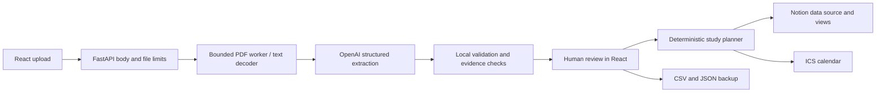

# Requirements and design decisions

## Scope decided before implementation

The core requirement is a reliable standalone daily planner: from reviewed module deadlines to a realistic study plan, recorded progress and early workload warnings. Notion is optional. The requested final stack is React/TypeScript and FastAPI. Reliability depends on two different kinds of work: uncertain language extraction and deterministic scheduling/export. They are kept separate.

| Requirement | Implementation | Deliberate boundary |
|---|---|---|
| Pull assessments from PDFs | Bounded local text extraction, chunking, OpenAI structured output | No OCR; source review is mandatory |
| Keep dates trustworthy | Nullable dates, source excerpts/pages, editable review gate | Quote matching is evidence location checking, not a proof that the extracted date is correct |
| Find workload pressure | Remaining hours due / still-available weekly capacity; module weights kept separate | Due-week pressure is a signal to start early; actual infeasibility is reported separately as shortfalls |
| Plan study | Earliest deadlines first; default allocation chooses less-loaded days, breaking ties toward earlier dates; optional latest-slot mode | Remaining hours are user estimates; not academic performance predictions |
| Track daily progress | Validated plan-snapshot session actions, occupied time history, done/move/undo | No automatic completion; finishing a session does not imply an assessment was submitted |
| Keep semesters | Browser localStorage library, legacy migration, JSON backups | Device-local persistence, no cloud account or cross-device merge |
| Respect real availability | Free weekdays, study window, time-off dates, deadline buffer | No automatic lecture/timetable or external calendar import |
| Organize in Notion | Data-source database, calendar and table views | One-way sync; official tokens required |
| Survive retries | Stable IDs, lookup before create, bounded read/update retries, explicit partial results | No distributed locks or exactly-once claims across multiple server instances |
| Demo without credentials | Synthetic fixture data, full manual entry, local exports | Demo does not pretend to make real AI or Notion requests |

## Data flow

`models.py` defines domain validation. `planner.py` is independent of HTTP and AI. `extraction.py` and `notion.py` own provider-specific behavior. FastAPI coordinates these modules; React owns user interaction and a persistent device-local semester library. There is no unnecessary repository/service abstraction for a database the application does not use.

## Extraction decisions

Each document is fingerprinted with SHA-256. Pages are labelled before chunking. Long pages overlap to reduce the chance of splitting table rows. Repeated chunks/identical uploads converge on stable item IDs derived from the document digest, module, assessment name and kind. If values conflict for the same identity, the app preserves the existing entry and reports the conflict. A changed source file may have a different digest; duplicate names and excessive module weights are surfaced for human cleanup.

The OpenAI request has no tools. The document is treated as untrusted data, not instructions. `responses.parse` produces a schema-constrained result, and conversion validates dates, times, ranges and evidence locations. Refused or incomplete responses do not import partial results from that file. Successful earlier files in a multi-file upload remain saved. Evidence that cannot be matched clears the proposed date/time and adds a review note. Even matched evidence never bypasses review.

## Planning rules

1. Generate valid free half-hour slots between `plan_from` and semester end, excluding unavailable weekdays/days off/past times.
2. Sort reviewed assessments by earliest due date, then stable ID for deterministic tie breaking.
3. Leave deadline day free. `buffer_days=1` also leaves the preceding day free.
4. Exclude completed/skipped history slots. Default mode allocates one session at a time to the least-loaded eligible day, breaking ties toward earlier dates. Deadline mode allocates the latest free slots first. Never reuse a slot.
5. Coalesce adjacent slots into blocks up to the chosen length.
6. Report any remaining effort as unscheduled. Unknown/out-of-semester/on-or-before-start deadlines produce explicit shortfalls.

The allocator uses integer minutes so it conserves effort without floating-point rounding. Work estimates must be multiples of 30 minutes. All-day deadlines remain all-day in exports. Timed dates and study blocks use IANA timezone rules; ambiguous or nonexistent deadline wall times are rejected. Slots crossing daylight-saving changes are skipped with a note. No study block crosses midnight.

## Progress and persistence

`Project.study_history` records each completed or moved session with its immutable scheduled interval. Done subtracts that session's minutes from remaining effort; moved sessions preserve effort. Both intervals are excluded from future allocation. Undo removes the entry and restores effort for completed sessions. Assessment submission is independent and reversible. The action endpoint rebuilds the supplied project against the plan response's timezone-aware `planned_at` snapshot, rejecting stale/missing sessions instead of accepting an arbitrary client duration. Changing estimates or availability may invalidate an old session action.

Session IDs include the assessment, start instant and duration, so a rescheduled session is a new identity. Project model validation rejects duplicate IDs, invalid durations and overlapping activity. Version 1 remains backward compatible: defaults fill new fields when loading older backups. The library stores separate projects by UUID. No raw PDFs or credentials are stored in the library.

## Focus and realistic weeks

Custom `weekly_windows` provide one local start and capacity per available weekday. When present, they replace `weekdays/day_start/daily_minutes` for allocation and capacity reporting. Validation rejects duplicate weekdays, unsupported day values and windows crossing midnight. Legacy settings remain compatible through an empty default list.

Checklist tasks have unique UUIDs and bounded titles; their done flags do not affect effort, review or scheduling. React updates a checklist tick immediately, validates it through the API and rolls back on failure. Planning depends on schedule-relevant fields so task and note edits preserve the current agenda and keyboard focus.

The focus timer stores its original project, session and planning snapshot in a separate localStorage key. Elapsed time uses wall-clock timestamps, so background throttling and reloads do not reset it. Pause freezes elapsed time. The timer never logs automatically; explicit logging uses the validated study-action endpoint, and a changed plan can invalidate the captured session. The timer cannot log into another semester.

New study actions record `logged_at` separately from the scheduled interval. Weekly goals count done activity by its actual completion date in the project timezone, with scheduled dates as the fallback for old backups. A goal is a progress target, not extra planner capacity.

## Sync semantics

A project has an immutable UUID stored in its JSON backup. Notion keys are scoped to that project and an assessment/block ID. The app reads all matching rows before writing. Repeated syncs update rows, preserving `Done`. Removed entries become `Lifecycle=Superseded` only after all current rows were written successfully. The generated views show `Lifecycle=Active`.

The database's technical title includes the project UUID so a lost create response can be recovered from the parent page's child databases. Its description contains the human semester name. Keep the title unchanged for create recovery. Connecting an existing database verifies its schema. Duplicate keys halt the sync before writes.

Requests are paced below Notion's documented average request rate. Rate-limit replies honor bounded `Retry-After`; reads and idempotent property updates can retry transient errors. New-page/database/view writes are not retried blindly after ambiguous transport/5xx failures. Partial results explain what was confirmed and invite a reconciling re-sync. If writes succeeded but view setup failed, rows remain and the warning instructs a retry.

## Security and operating model

Secrets are environment-only. The application never writes raw uploads to a persistent store or serializes credentials into a project. Browser-origin controls require a custom header on mutations, restrict CORS to development origins, validate hosts, and cap request bodies before multipart parsing. React escapes displayed text; it never renders document text as HTML. CSV exports prefix spreadsheet formula triggers. IDs cannot turn a Notion request into an arbitrary URL.

These controls do not replace authentication. This release is scoped to one local operator with their own API credentials. Browser localStorage is convenient device-local state, not authenticated server-side storage. Public multi-user operation requires a different credential/isolation design and operational monitoring. Long-running extraction/sync requests continue on the backend if the browser disconnects; the app does not claim cancellation or resumable background jobs. A restart loses in-flight work, so keep backups and use repeat-safe sync recovery.

## Known functional limits

- AI extraction can omit or misinterpret an assessment even when output is schema-valid. Review both the source and the complete extracted list.
- Teaching-week breaks/renumbering need manual review; semester-start edits do not automatically shift deadlines.
- Scheduling is a feasible-slot heuristic. It does not optimize learning science, task dependencies, breaks within the available window, or user energy levels.
- The app does not import Notion completion changes or merge simultaneous edits across devices.
- ICS files are snapshots; different calendar apps handle repeat imports differently. Use a dedicated imported calendar that can be replaced.
- Running multiple backend workers bypasses the in-process operation locks; use one worker in this release.

## Protected time and recovery

`Settings.commitments` contains bounded, uniquely identified local intervals. A null date means weekly recurrence on its weekday; a date overrides the weekday for a one-off event. Intervals must end after they start on the same day, and one-off dates must be inside the semester. `extra_windows` adds bounded, half-hour-aligned study intervals on specific semester dates. Both lists default empty for older backups.

The allocator unions regular and extra half-hour slots, then excludes any overlap with a matching commitment, logged or moved history, days off, invalid DST times and elapsed slots. Weekly capacity uses this same allocator. A partial overlap removes the full half-hour. Separate surviving groups cannot coalesce across protected gaps.

`POST /api/recovery` builds a baseline and bounded alternatives at one server timestamp. Only alternatives that reduce total shortfall are offered, with per-assessment changes and exact added windows. The next-14-day candidate search adds at most 30 minutes per eligible day near existing hours, between 07:00 and 22:00, and keeps still-free daily capacity at or below eight hours. It respects commitments, days off and history. An extra buffer can be reduced to zero; deadline day remains unavailable.

`POST /api/recovery/apply` recomputes the chosen option at the current instant and compares its settings with the reviewed `expected_settings`. A changed option is rejected with 409. These endpoints perform no AI, Notion or external service calls. The client undo merges only prior settings into the latest project, preserving progress and assessment edits, and disables itself after a subsequent settings change. Settings/commitment editors also save against the latest project instead of overwriting progress captured while a dialog was open.

Navigation is selected before asynchronous semester loading so a later user tab choice is preserved.

## Reviewed chat and session estimates

`POST /api/assistant/propose` requires explicit provider consent and a bounded conversation. It reuses the server-only extraction provider configuration and Responses structured parsing, with `store=False`. The model interprets only commitment and remaining-effort changes; it cannot apply a project or write to external tools. Uncertain requests are atomic clarifications with empty changes. Local validation rejects unknown IDs, submitted assessments, invalid intervals, out-of-semester dates, duplicate changes and unsupported effort amounts. AI SDK failures return sanitized errors, and a per-process lock bounds concurrent chat interpretation.

Every proposal captures a SHA-256 signature of project identity, complete settings, scheduling-relevant assessment fields and activity history. Notes and checklist changes are deliberately excluded and survive the client's limited-field merge. A proposal also carries a digest of its reviewed content/metrics. `POST /api/assistant/review` recomputes the deterministic plan and refreshes that digest after editable proposal changes. `POST /api/assistant/apply` checks project signature, aware timestamp/15-minute expiry and the unchanged reviewed-content digest before applying only commitment/effort fields. The digest binds accidental edits to preview refresh; it is not authentication or an authorization token. As with other local endpoints, the client supplies the current project.

The client captures its planning/history snapshot before asynchronous requests and checks against the latest project before saving, preserving newer direct edits even if a response arrives late. An edited proposal hides its old impact metrics until refreshed. Semester switches remount chat state; closing the panel preserves the current conversation without leaving hidden controls in other forms.

`POST /api/estimates/check-in` applies explicit feedback to the latest done activity for the assessment, checking the expected current remaining effort and rejecting repeated checks, submitted assessments and stale sessions. Activity stores the estimate before logging and feedback before/after values separately from actual logged duration. On-track feedback preserves remaining work, need-more-time increases it and finished requires zero. Submission and review flags never change. Undo restores a feedback estimate only when its activity is still latest and the estimate matches the reported value, otherwise it restores session minutes to the current estimate.

Personal suggestions run entirely in the browser across saved non-demo semesters. They require at least three fully completed same-type assessments with positive done logs, prefer same-module samples when sufficient, limit the pool to the latest 20 and round the median total to half-hour steps. Already logged minutes are subtracted for the editable remaining-work suggestion. A work-finished check-in or a zero-remaining submitted assessment qualifies; skipped and undone sessions do not count. Suggestions never apply automatically and cannot infer unlogged study.

## Scheduling/help scope and daily budget

Chat interpretation now has required schedule/help/out_of_scope intents and a bounded trusted help-topic enum. Only schedule intent can build changes; help/out-of-scope responses discard every proposed mutation and replace the model text with app-maintained help or scope guidance. Common explicit interface questions are answered locally before loading provider configuration. Responses parsing uses the existing provider/deployment, `store=False`, no automatic retries and a 2,500-output-token ceiling.

`GET /api/assistant/usage` exposes the local budget. Each accepted send reserves one of 25 daily slots before any AI call, using SQLite `BEGIN IMMEDIATE` and an atomic count update. The budget is shared across projects, browsers and workers using that data directory, survives restarts and resets at midnight in Europe/Dublin (including DST). Failed provider attempts count conservatively. Unsupported/consent/configuration rejection before a provider attempt and preview review/apply do not consume a send. Usage metadata is excluded from the reviewed-content digest and cannot alter mutations.

The default database is `.local/chat_usage.sqlite3`, ignored by Git and containing no messages or student records. `CRUNCH_WEEK_DATA_DIR` is a trusted server setting for persistent deployment storage or isolated QA counters. Missing/unwritable/corrupt storage fails closed with 503 before a provider call. This local release has no student authentication: the budget is per installation, not per authenticated student or API key across unrelated installations. Keep the same persistent data directory when restarting the app.

Availability entry buttons wait for pending saves so an editor cannot open using pre-undo settings.

## Document ingestion refinements

PDF ingestion compares layout extraction against plain-token coverage and falls back if layout fails or omits text. Non-text painted/image pages require OCR; genuine blanks keep their physical source slots and create a visible warning. The existing subprocess, memory/content limits and wall-time timeout remain in force. Chunking prefers whole lines, carries bounded preceding context across page/chunk boundaries and attaches short identity-only header context without a second AI pass.

ZIP virtual-page markers retain full member paths to distinguish identical filenames. Failures in otherwise supported members are surfaced in `Document.warnings` and extraction warnings. Aggregate source indices allow 150 pages for supported packages. Evidence matching normalizes ligatures, soft hyphens and line-wrapped words; a unique exact match can repair its source index. Ambiguous/unmatched evidence clears date/time/weight rather than retaining ungrounded metadata. Date and time validation are independent, so a valid date survives an invalid time. Unknown/AI-interpreted dates still require student review.
